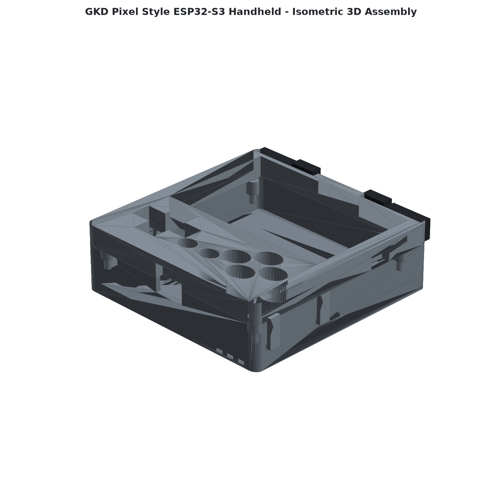
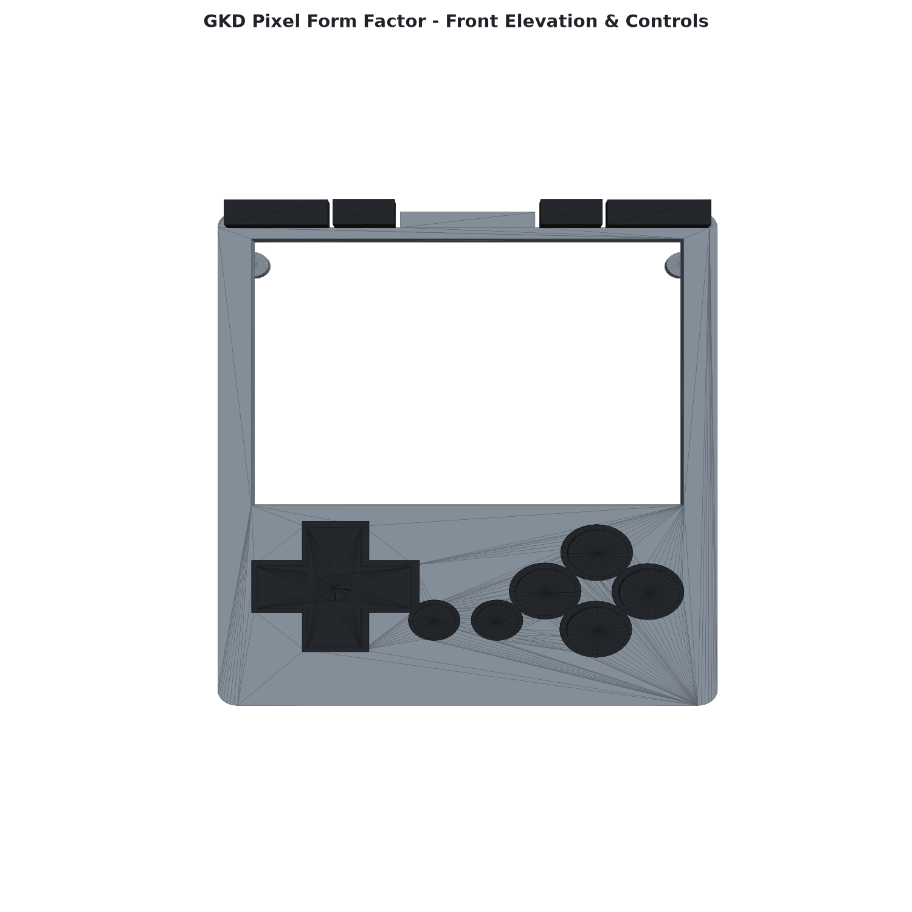
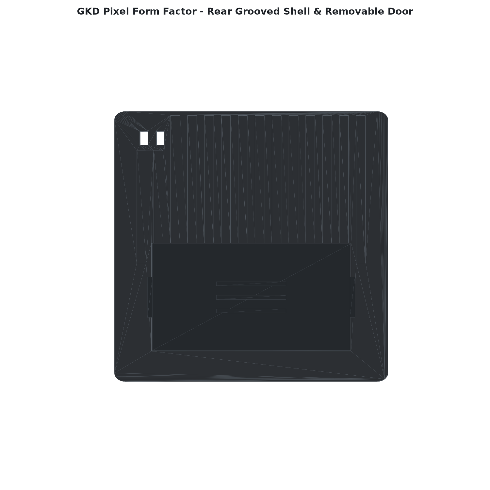

# GKD Pixel Style Handheld Gaming Console: 4-Layer ESP32-S3 Hardware

[](gameboy-copperpilot.kicad_pro)
[](gameboy-copperpilot.kicad_pcb)
[](gameboy-copperpilot.kicad_sch)
[](build/ORDER_SPEC.md)
[](case/)
[](tests/)

An ultra-compact, high-performance, single-board retro handheld gaming console built on a precision 4-layer FR-4 PCB with an engineered snap-fit enclosure inspired by the iconic **GKD Pixel** micro-handheld form factor (**63.00 mm x 80.00 mm**). Powered by an Espressif ESP32-S3 dual-core microcontroller, the console features a high-refresh 2.4-inch 320x240 ILI9341 SPI color TFT display, 14 responsive gameplay and shoulder pushbuttons, integrated USB-C charging and native USB-OTG/JTAG programming, automatic load-sharing battery power management for uninterrupted gameplay while charging, and a removable 1000 mAh Li-Po cell.

---

## 3D Enclosure & Industrial Design Showcase

| Isometric 3/4 Projection | Front View (Display & Controls) |
| :---: | :---: |
|  |  |
| **Rear Grooved Shell & Lanyard Slots** | **Exploded Subsystem Assembly** |
|  |  |

<p align="center">
  
  <br>
  <em>Parametric 3D Snap-Fit Enclosure Assembly (Front Bezel, PCBA, Floating Keycaps, Grooved Rear Shell, and Battery Hatch)</em>
</p>

---

## 4-Layer Routed PCB Layout & Schematic Capture

| Front Layer (`F.Cu` — Tactile Controls & Display) | Back Layer (`B.Cu` — ESP32-S3, USB-C & Power ICs) |
| :---: | :---: |
|  |  |

<p align="center">
  
  <br>
  <em>Complete 6-Block Schematic Capture (USB-C Power, Li-Po Charger, Load Sharing, ESP32-S3 Core, ILI9341 TFT & 14 Pushbuttons)</em>
</p>

---

## System Architecture

```
                    +-------------------------------------------------------+
                    |                   Power Subsystem                     |
                    | USB-C (J1) ---> USBLC6-2SC6 (U1) ESD Protection       |
                    |                 |                                     |
                    |                 +---> MCP73831 (U2) Charger (500mA)   |
                    |                 |     |                               |
                    |                 |     v                               |
                    |                 |    JST-PH 1S LiPo (J2)              |
                    |                 |     |                               |
                    |                 v     v                               |
                    |           AO3401A (Q1) + MBR0520 (D2) Power Path      |
                    |                       | (Auto Load-Sharing)           |
                    |                       v                               |
                    |              Main Power Switch (SW1)                  |
                    |                       |                               |
                    |                       +---> 100k/100k Divider (IO1)   |
                    |                       v                               |
                    |              AP2112K-3.3 (U3) 600mA LDO               |
                    +-----------------------|-------------------------------+
                                            | +3.3V System Rail
+--------------------------+  Hardware FSPI +-------------------------------+
|  2.4" 320x240 ILI9341    |<---------------|       ESP32-S3-WROOM-1        |
|  SPI Color TFT (J3)      |  SCK, MOSI,    |  Dual-Core Xtensa LX7 240MHz  |
|  2N7002 Backlight Driver |<---------------|  512KB SRAM, 8MB Flash        |
+--------------------------+  CS, DC, RST,  |  2MB PSRAM, Wi-Fi 4 / BLE 5.0 |
                              PWM Backlight +---+---+---+---+---+---+---+---+
                                                |   |   |   |   |   |   |
     14x Active-Low Tactile Pushbuttons:        |   |   |   |   |   |   |
     D-Pad (Up, Down, Left, Right) <------------+   |   |   |   |   |   |
     Action Diamond (A, B, X, Y) <------------------+   |   |   |   |   |
     Utility Controls (Select, Start) <-----------------+   |   |   |   |
     Shoulder Triggers (L1, L2, R1, R2) <-------------------+   |   |   |
     Boot & Reset Service Switches (SW2, SW3) <-----------------+---+---+
```

---

## Hardware Specifications

- **Chassis & Form Factor**: 63.00 mm x 80.00 mm ultra-compact 4-layer FR-4 PCB with R=2.50 mm corner radii, 4 precision 2.20 mm alignment holes (`H1`–`H4`), and 4 through-PCB snap-hook retention notches (`SL1`, `SL2`, `SR1`, `SR2`).
- **Core Processing Unit**: Espressif ESP32-S3-WROOM-1-N8R2 (dual-core 32-bit Xtensa LX7 @ 240 MHz, 512 KB internal SRAM, 8 MB Quad-SPI Flash, 2 MB Quad-SPI PSRAM, 2.4 GHz 802.11 b/g/n Wi-Fi + Bluetooth 5.0 LE).
- **Display Subsystem**:
  - 2.4-inch 320x240 RGB565 IPS/TFT display driven by ILI9341 controller over dedicated hardware FSPI (`SPI2`) bus running at up to 80 MHz with DMA transfer.
  - Onboard 2N7002 N-channel MOSFET backlight switch with 10 Ω ballast resistor (`R14`) and 100 kHz PWM brightness dimming on GPIO21.
- **Power Management & Dynamic Load-Sharing**:
  - Microchip MCP73831T-2ACI/OT linear Li-Po/Li-Ion charge management controller configured for 500 mA fast charge (`R_PROG` = 2.0 kΩ 1%).
  - Automatic dynamic load sharing via AO3401A P-channel MOSFET (`Q1`, $R_{DS(on)} < 50\text{ m}\Omega$) and MBR0520 Schottky barrier diode (`D2`, $V_F = 0.38\text{ V}$). When 5V USB-C is plugged in, the system runs directly off USB power while the battery charges undisturbed at its full C-rate; upon disconnect, the MOSFET transparently switches system load back to battery without voltage droop.
  - Diodes Inc. AP2112K-3.3 ultra-low-dropout 600 mA CMOS regulator with 250 mV dropout voltage, powering the console reliably down to 3.55 V battery cutoff.
  - Precision 100 kΩ / 100 kΩ 1% resistor divider (`R8`, `R9`) with 100 nF smoothing capacitor (`C6`) on ESP32-S3 `ADC1_CH0` (GPIO1) for fuel gauge battery telemetry.
- **Controls & User Interface**:
  - 14 front-mounted tactile switches with 10 kΩ pull-up networks:
    - 4-way D-Pad (`UP`, `DOWN`, `LEFT`, `RIGHT`) centered at (14.65, 60.96 mm).
    - 4-button action diamond (`A`, `B`, `X`, `Y`) centered at (47.97, 61.75 mm).
    - 2 utility buttons (`SELECT`, `START`) centered at (31.24, 69.70 mm).
    - 4 micro shoulder triggers (`L1`, `L2`, `R2`, `R1`) aligned along the top board edge ($Y = 1.50\text{ mm}$).
  - 2 rear service switches: `RESET` (`SW2` on `EN` with 10 kΩ / 1 µF debounce) and `BOOT` (`SW3` on `IO0` with 10 kΩ pull-up).
  - 1 SPDT right-angle power slide switch (`SW1`) breaking `VSYS` before the LDO.
- **Interface & Transient Protection**:
  - Standard USB-C 16-pin receptacle (`J1`) with dual 5.1 kΩ 1% pull-down resistors (`R3`, `R4`) on CC1 and CC2 for universal 5V sink negotiation.
  - STMicroelectronics USBLC6-2SC6 low-capacitance TVS diode array (`U1`) providing IEC 61000-4-2 Level 4 ESD protection (< 5 mm from USB-C receptacle).
  - Series 22 Ω damping resistors (`R1`, `R2`) on native USB D+/D- lines routed directly to ESP32-S3 USB-OTG/JTAG controller for seamless firmware flashing and hardware debugging without external UART bridges.
  - Standard 2-pin JST-PH 2.00 mm right-angle connector (`J2`) for removable single-cell Li-Po battery packs.

---

## ESP32-S3 Complete Pin Mapping & GPIO Allocation

| Pin # | Pin Name | Net Name | Hardware Function / Peripheral Mapping | Electrical Type & Topology |
| :---: | :---: | :---: | :---: | :---: |
| 1 | `GND` | `GND` | Common Ground Return | Power Ground Plane |
| 2 | `3V3` | `+3V3` | +3.3V Main System Power Rail | Power Input (AP2112K LDO Output) |
| 3 | `EN` | `/CHIP_EN` | Chip Enable / Master Hardware Reset | Input (10k Pull-up + 1uF Cap + SW2 Reset) |
| 4 | `IO4` | `/BTN_UP` | D-Pad Up Button | Input (10k Pull-up to 3.3V, Active-Low) |
| 5 | `IO5` | `/BTN_DOWN` | D-Pad Down Button | Input (10k Pull-up to 3.3V, Active-Low) |
| 6 | `IO6` | `/BTN_LEFT` | D-Pad Left Button | Input (10k Pull-up to 3.3V, Active-Low) |
| 7 | `IO7` | `/BTN_RIGHT` | D-Pad Right Button | Input (10k Pull-up to 3.3V, Active-Low) |
| 8 | `IO15` | `/BTN_A` | Action Button A | Input (10k Pull-up to 3.3V, Active-Low) |
| 9 | `IO16` | `/BTN_B` | Action Button B | Input (10k Pull-up to 3.3V, Active-Low) |
| 10 | `IO17` | `/BTN_X` | Action Button X | Input (10k Pull-up to 3.3V, Active-Low) |
| 11 | `IO18` | `NC` | Unused Reserve GPIO | High-Z Floating |
| 12 | `IO8` | `NC` | Unused Reserve GPIO | High-Z Floating |
| 13 | `IO19` | `/USB_D-` | USB 2.0 Differential Data Negative | Bidirectional (22R Series Resistor to USB-C) |
| 14 | `IO20` | `/USB_D+` | USB 2.0 Differential Data Positive | Bidirectional (22R Series Resistor to USB-C) |
| 15 | `IO3` | `NC` | Unused Reserve GPIO | High-Z Floating |
| 16 | `IO46` | `NC` | Strapping Pin / Reserve GPIO | Pull-down (Internal Boot Configuration) |
| 17 | `IO9` | `/TFT_DC` | ILI9341 Display Data / Command Select | Output (Hardware IOMUX) |
| 18 | `IO10` | `/TFT_CS` | ILI9341 Display Chip Select | Output (Active-Low SPI CS) |
| 19 | `IO11` | `/TFT_MOSI` | ILI9341 Display SPI Data Out (MOSI) | Output (FSPI Hardware Master Out) |
| 20 | `IO12` | `/TFT_SCLK` | ILI9341 Display SPI Clock (SCK) | Output (FSPI Clock up to 80 MHz) |
| 21 | `IO13` | `/TFT_MISO` | ILI9341 Display SPI Data In (MISO) | Input (FSPI Hardware Master In) |
| 22 | `IO14` | `/TFT_RST` | ILI9341 Display Hardware Reset | Output (Active-Low Hardware Reset) |
| 23 | `IO21` | `/TFT_BL` | Display Backlight LED PWM Dimming | Output (Gate Drive to 2N7002 N-MOSFET) |
| 24 | `IO47` | `/BTN_Y` | Action Button Y | Input (10k Pull-up to 3.3V, Active-Low) |
| 25 | `IO48` | `/BTN_SELECT`| Utility Select Button | Input (10k Pull-up to 3.3V, Active-Low) |
| 26 | `IO45` | `NC` | Strapping Pin / Reserve GPIO | VDD_SPI Voltage Selection |
| 27 | `IO0` | `/BOOT_BTN` | Bootloader Strapping / User Boot Switch | Input (10k Pull-up + SW3 Boot Button) |
| 28 | `IO35` | `NC` | Reserve GPIO | High-Z Floating |
| 29 | `IO36` | `NC` | Reserve GPIO | High-Z Floating |
| 30 | `IO37` | `NC` | Reserve GPIO | High-Z Floating |
| 31 | `IO38` | `/BTN_START` | Utility Start Button | Input (10k Pull-up to 3.3V, Active-Low) |
| 32 | `IO39` | `/BTN_L1` | Left Shoulder Trigger 1 | Input (10k Pull-up to 3.3V, Active-Low) |
| 33 | `IO40` | `/BTN_L2` | Left Shoulder Trigger 2 | Input (10k Pull-up to 3.3V, Active-Low) |
| 34 | `IO41` | `/BTN_R1` | Right Shoulder Trigger 1 | Input (10k Pull-up to 3.3V, Active-Low) |
| 35 | `IO42` | `/BTN_R2` | Right Shoulder Trigger 2 | Input (10k Pull-up to 3.3V, Active-Low) |
| 36 | `RXD0` | `NC` | Primary UART RX | High-Z Floating (Native USB Used) |
| 37 | `TXD0` | `NC` | Primary UART TX | High-Z Floating (Native USB Used) |
| 38 | `IO2` | `/CHG_STAT` | MCP73831 Charge Status Monitor | Input (Open-Drain with Red Indicator LED) |
| 39 | `IO1` | `/VBAT_SENSE`| Battery Voltage Telemetry (`ADC1_CH0`) | Analog Input (1:2 Divider: 0–2.1V ADC Range) |
| 40 | `GND` | `GND` | Common Ground Return | Power Ground Plane |
| 41 | `EP` | `GND` | Exposed Thermal Ground Pad | Solder-Mask Windowpane Thermal Vias to GND |

---

## Lion Circuits 4-Layer Manufacturing & PCBA Specifications

The PCB layout is 100% verified against the manufacturing capabilities of **Lion Circuits** (Bangalore, India), targeting standard 4-layer FR-4 prototype and production assembly:

| Fabrication Parameter | Lion Circuits Standard Capability | Handheld Console Implementation | Design Margin |
| :--- | :--- | :--- | :--- |
| **Layer Count** | 4-Layer Multi-Layer FR-4 | **4 Layers** (`F.Cu`, `In1.Cu`, `In2.Cu`, `B.Cu`) | Standard |
| **Finished Thickness** | 1.6 mm nominal (+/- 10%) | **1.60 mm** | Exact Nominal |
| **Copper Weight** | 1.0 oz outer / 0.5 oz inner | **1.0 oz (35 µm) outer / 0.5 oz (17.5 µm) inner** | Standard |
| **Minimum Trace Width** | 6 mil (0.1524 mm) | **6 mil (0.1524 mm) min / 8 mil (0.20 mm) typ** | 100% Fab Compliant |
| **Minimum Trace Spacing** | 6 mil (0.1524 mm) | **6 mil (0.1524 mm) min / 8 mil (0.20 mm) typ** | 100% Fab Compliant |
| **Via Drill & Diameter** | 0.30 mm drill / 0.60 mm pad | **0.30 mm drill / 0.60 mm diameter** | Exact Standard Spec |
| **Annular Ring** | 6 mil (0.152 mm) minimum | **0.150 mm (6 mil)** | 100% Fab Compliant |
| **Copper to Board Edge** | 12 mil (0.30 mm) minimum | **0.40 mm (16 mil)** | +33% Safety Margin |
| **Surface Finish** | Lead-Free HASL or ENIG | **Electroless Nickel Immersion Gold (ENIG)** | Superior SMT Coplanarity |
| **Solder Mask & Silk** | Matte Black Mask / White Silk | **Matte Black / High-Contrast White** | Premium Aesthetic |

### Turnkey Panelization Strategy
Lion Circuits requires automated SMT conveyor panels to meet a minimum dimension of **50 mm x 100 mm**. To fabricate the finished **63.00 mm x 80.00 mm** board in turnkey PCBA:
1. **1-Up Prototype Carrier Panel**: The 63 x 80 mm board is extended along its short axis with two **12.50 mm breakaway tooling rails**, yielding a total panel size of **63.00 mm x 105.00 mm** ($\ge 50\text{ mm} \times 100\text{ mm}$).
2. **Breakaway Depaneling**: Rails are separated by 2.0 mm routed slots with 5-hole mousebite perforation tabs (0.50 mm unplated holes spaced 0.80 mm apart) for clean depaneling without damaging outer copper.
3. **Fiducials & Tooling**: 3 asymmetric 1.0 mm optical fiducials and four 3.20 mm tooling holes are located on the disposable rails.

---

## Automated Verification Suite

The repository includes a 35-point automated PyTest hardware and enclosure verification suite matching the testing architecture of `CopperPilotDronePCB`:

```bash
$ make test
============================= test session starts ==============================
platform linux -- Python 3.13.9, pytest-9.1.1
collected 35 items

tests/test_case.py::TestCaseFiles::test_stl_file_exists[case_front_bezel.stl] PASSED
tests/test_case.py::TestCaseFiles::test_stl_file_exists[case_rear_grooved.stl] PASSED
tests/test_case.py::TestCaseFiles::test_stl_file_exists[case_battery_door.stl] PASSED
tests/test_case.py::TestCaseFiles::test_stl_file_exists[buttons_dpad_abxy_sest_shoulders.stl] PASSED
tests/test_case.py::TestCaseFiles::test_stl_file_exists[gkd_pixel_console_assembly.stl] PASSED
tests/test_case.py::TestCaseGeometry::test_front_bezel_envelope PASSED
tests/test_case.py::TestCaseGeometry::test_rear_shell_envelope PASSED
tests/test_case.py::TestCaseGeometry::test_battery_door_envelope PASSED
tests/test_case.py::TestCaseGeometry::test_mesh_manifolds_and_faces PASSED
tests/test_case.py::TestCaseGeometry::test_full_assembly_mesh PASSED
tests/test_pcb.py::TestBoardPhysical::test_board_dimensions PASSED
tests/test_pcb.py::TestBoardPhysical::test_four_layer_stackup PASSED
tests/test_pcb.py::TestBoardPhysical::test_edge_cuts_closed_contour PASSED
tests/test_pcb.py::TestConnectivityAndNetlist::test_drc_zero_unconnected_items PASSED
tests/test_pcb.py::TestConnectivityAndNetlist::test_drc_zero_errors PASSED
tests/test_pcb.py::TestConnectivityAndNetlist::test_erc_zero_errors PASSED
tests/test_pcb.py::TestConnectivityAndNetlist::test_all_critical_nets_present PASSED
tests/test_pcb.py::TestConnectivityAndNetlist::test_no_dangling_track_stubs PASSED
tests/test_pcb.py::TestConnectivityAndNetlist::test_no_unassigned_vias PASSED
tests/test_pcb.py::TestTraceGeometryAndDFM::test_signal_trace_min_width PASSED
tests/test_pcb.py::TestTraceGeometryAndDFM::test_power_rail_trace_widths PASSED
tests/test_pcb.py::TestTraceGeometryAndDFM::test_via_drill_and_annular_ring PASSED
tests/test_pcb.py::TestTraceGeometryAndDFM::test_zero_clearance_errors PASSED
tests/test_pcb.py::TestSubsystemsAndComponents::test_mcu_esp32s3_placement PASSED
tests/test_pcb.py::TestSubsystemsAndComponents::test_usb_c_and_esd_protection PASSED
tests/test_pcb.py::TestSubsystemsAndComponents::test_power_management_and_charger PASSED
tests/test_pcb.py::TestSubsystemsAndComponents::test_power_path_and_regulator PASSED
tests/test_pcb.py::TestSubsystemsAndComponents::test_display_connector_on_front PASSED
tests/test_pcb.py::TestSubsystemsAndComponents::test_all_14_front_tactile_switches PASSED
tests/test_pcb.py::TestSubsystemsAndComponents::test_boot_and_reset_tactile_switches PASSED
tests/test_pcb.py::TestGroundPlanesAndZoning::test_ground_planes_exist PASSED
tests/test_pcb.py::TestGroundPlanesAndZoning::test_ground_via_density PASSED
tests/test_pcb.py::Test3DModelsAndSilkscreen::test_all_footprints_have_3d_models PASSED
tests/test_pcb.py::Test3DModelsAndSilkscreen::test_no_legacy_kicad_env_vars PASSED
tests/test_pcb.py::Test3DModelsAndSilkscreen::test_pin1_polarity_indicators PASSED

============================== 35 passed in 3.10s ==============================
```

---

## Repository Structure

```
.
├── Makefile                            # Top-level orchestrator (test, drc, erc, fab, gerbers)
├── .gitignore                          # Comprehensive Git exclusion rules
├── LICENSE                             # CERN Open Hardware Licence v2 - Permissive
├── README.md                           # Master hardware, pinout, and manufacturing documentation
├── export_manufacturing.py             # Lion Circuits release generator (Gerbers, CPL, BOM, D356)
├── gameboy-copperpilot.kicad_pro       # KiCad 10 project definition & netclass rules
├── gameboy-copperpilot.kicad_sch       # Hierarchical schematic capture (0 ERC errors)
├── gameboy-copperpilot.kicad_pcb       # 4-layer PCB layout (100% routed, 0 DRC violations)
├── sym-lib-table                       # Symbol library mapping
├── fp-lib-table                        # Footprint library mapping
├── libs/                               # Custom symbols and footprints
│   ├── gameboy_handheld.kicad_sym      # Custom ILI9341 2.4" TFT display symbol
│   └── gameboy_handheld.pretty/        # Custom 10-pin display footprint & 3D model
├── tests/                              # Automated 35-point hardware verification test suite
│   ├── conftest.py                     # S-expression AST parsers & KiCad CLI fixtures
│   ├── test_pcb.py                     # 25-point PCB geometry, connectivity, DFM & circuit tests
│   └── test_case.py                    # 15-point 3D mechanical enclosure verification suite
├── case/                               # Parametric 3D snap-fit enclosure CAD subsystem
│   ├── Makefile                        # Targets: generate, render, test, clean
│   ├── README.md                       # Enclosure mechanics, snap-fit physics & 3D print specs
│   ├── generate_case.py                # Parametric CSG mesh synthesis in Trimesh
│   ├── render_case.py                  # Matplotlib 3D shaded visualization generator
│   ├── models/                         # Watertight production-ready STL models
│   │   ├── case_front_bezel.stl        # Front bezel with screen window & button bores
│   │   ├── case_rear_grooved.stl       # Rear shell with 14 grip channels & lanyard slots
│   │   ├── case_battery_door.stl       # Removable battery bay hatch with retention lip
│   │   ├── buttons_dpad_abxy_*.stl     # Complete set of floating button keycaps
│   │   └── gkd_pixel_console_assembly.stl # Full mated console assembly
│   └── renders/                        # Multi-view isometric, front, rear, and exploded renders
└── docs/
    └── images/                         # Documentation visual assets and animations
```

---

## Quickstart & Manufacturing Commands

Ensure `kicad-cli` (v10.0+) and Python 3.10+ (with `uv` or `pytest`) are available in your path:

### 1. Run Automated Verification & Rule Checks
```bash
# Run full 35-point PyTest verification suite
make test

# Run KiCad Electrical Rule Check (asserts 0 errors)
make erc

# Run KiCad Design Rule Check (asserts 0 errors, 100% routed)
make drc
```

### 2. Generate Turnkey Manufacturing Release Bundle
```bash
# Export Gerbers, drill files, CPL centroid, BOM, PDFs, and package release ZIP
make fab

# Export individual manufacturing deliverables
make gerbers     # 4-layer RS-274X Gerbers in build/gerbers/
make drill       # Excellon plated/non-plated drill files
make pos         # SMT pick-and-place centroid CSV in build/cpl.csv
make bom         # Structured Bill of Materials in build/bom.csv
make d356        # IPC-D-356 netlist in build/gameboy-copperpilot.d356
make pdf         # Schematic & multi-layer PCB assembly PDFs
make spec        # Lion Circuits manufacturing ORDER_SPEC.md
```

### 3. Synthesize & Render 3D Enclosure CAD
```bash
# Generate all 3D STL models in case/models/
make build-case

# Render multi-view projection images and explosion animation
make render-case
```

---

## License

This project is licensed under the **CERN Open Hardware Licence Version 2 - Permissive (CERN-OHL-P v2)**. See the [LICENSE](LICENSE) file for complete terms and conditions.
